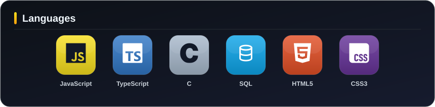
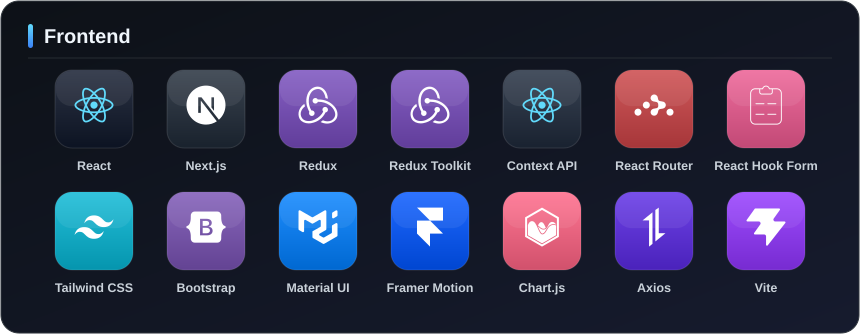
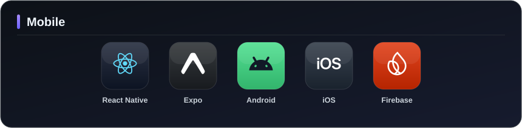
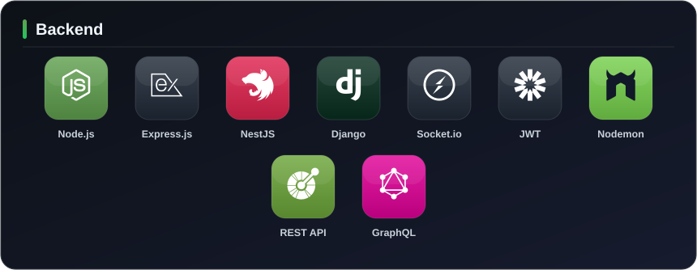
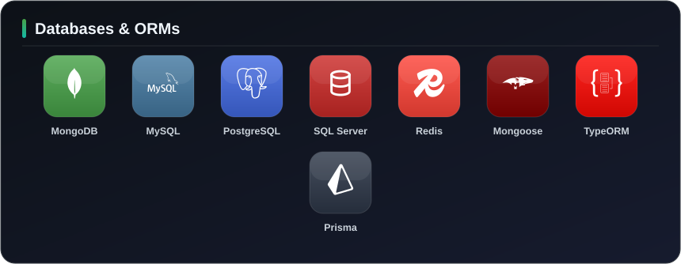
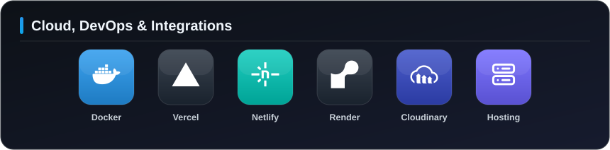
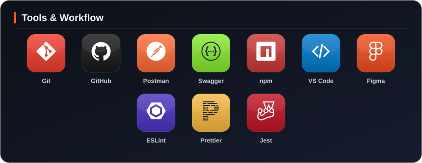
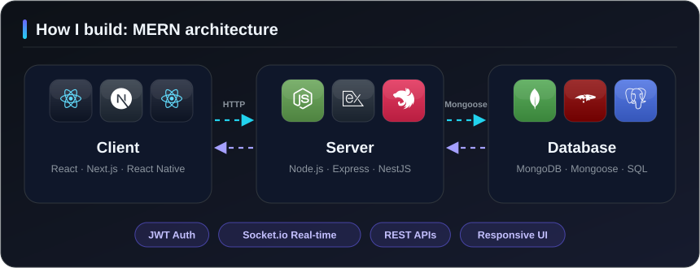

  

  
  
  
  

---

## About Me

I am a **Full Stack Developer** with **1.5+ years** of professional experience building production-ready web and mobile applications. I build responsive **React / Next.js** interfaces, scalable **Node.js / Express / NestJS** APIs, and cross-platform apps with **React Native**.

<table>
  <tr>
    <td width="33%" valign="top">
      <b>Education</b> 
      BCA (Bachelor of Computer Applications) | 2025
    </td>
    <td width="33%" valign="top">
      <b>Location</b> 
      Uttar Pradesh, India
    </td>
    <td width="33%" valign="top">
      <b>Open to</b> 
      Full Stack and React Native roles
    </td>
  </tr>
</table>

---

## What I Do

| Web Applications | Mobile Applications | APIs & Backend |
|:----------------:|:-------------------:|:--------------:|
| Responsive, fast UIs with React and Next.js | Cross-platform Android and iOS apps with React Native | REST APIs, JWT auth and real-time features with Node.js, Express and NestJS |

---

## Experience

| Role | Company | Duration |
|------|---------|----------|
| Software Developer | **Elation SoftNet Pvt. Ltd.**, Lucknow | May 2026 - Present |
| Software Developer | **Techpile Technology Pvt. Ltd.**, Lucknow | Apr 2025 - Apr 2026 |

---

## Tech Stack

---

## Architecture

---

## GitHub Activity

  

---

## Let's Connect

I am always open to discussing new projects, collaborations and opportunities.

  
  
  

  

